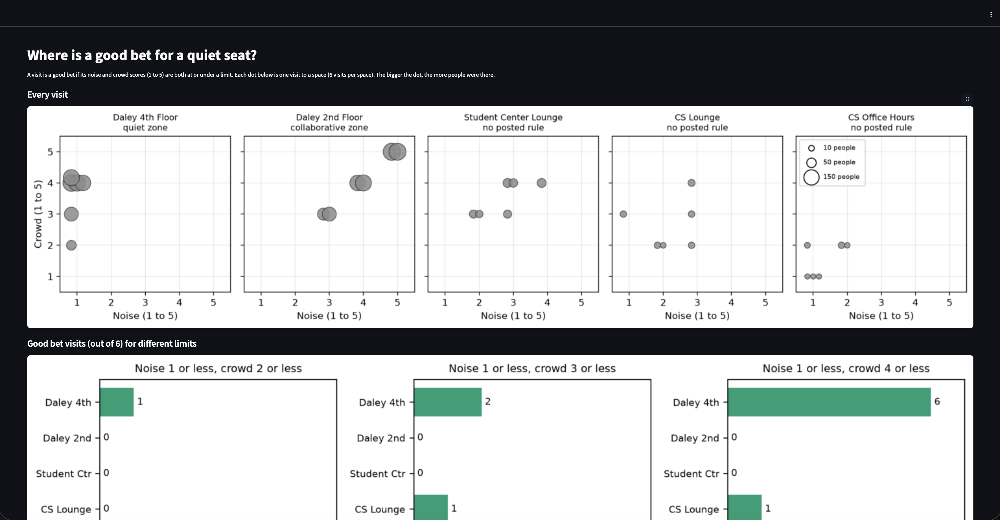
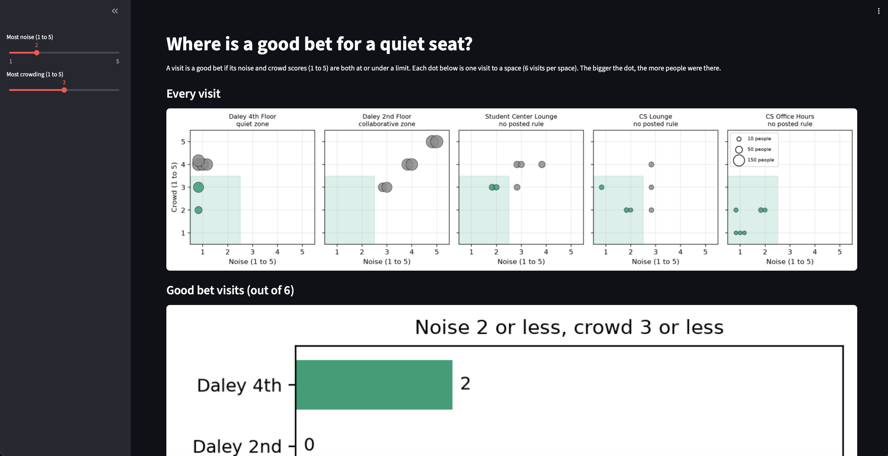
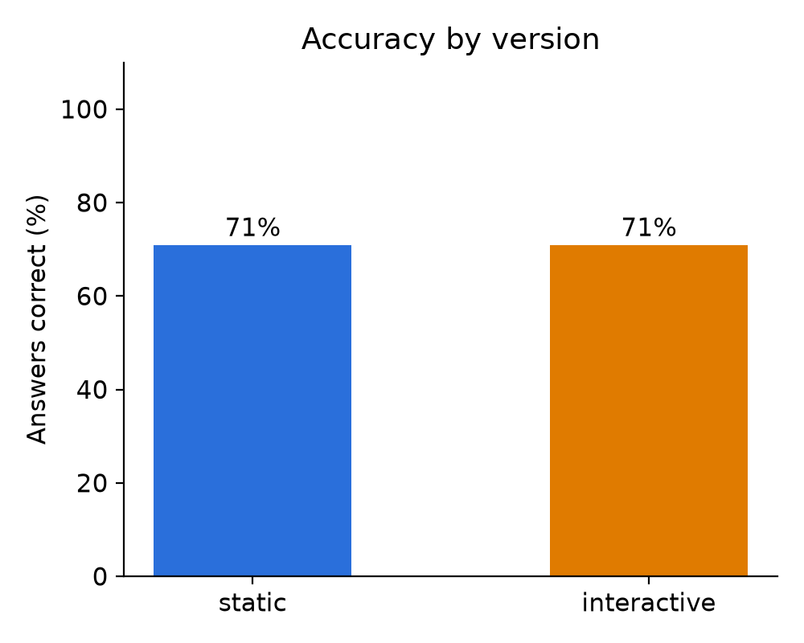
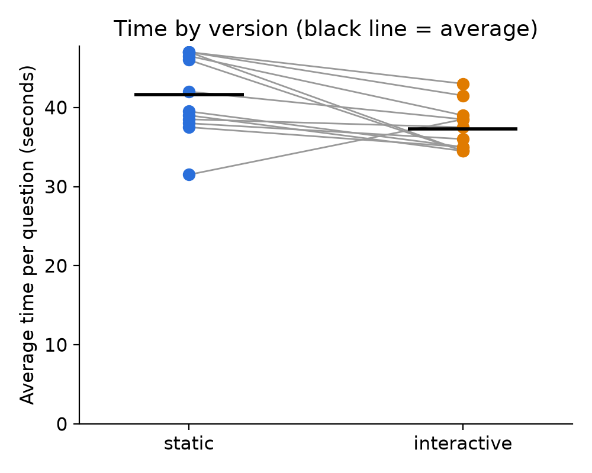

# Assignment 3
# Task 1: Implementing interaction

I picked my “good bet for a quiet seat” chart because the answer depends on where you draw the line. A visit counts as a good bet when its noise and crowd scores are under your limits. The quiet floor of the library had 2 good visits with a crowd limit of 3, but 6 with a limit of 4. Both versions use the same data and the same dot charts. There’s one small chart for each space, a dot for every visit, and bigger dots mean more people were there.

In the interactive version you move two sliders to set the most noise and the most crowding you’ll put up with. A green box moves across the dot charts, the dots inside it turn green, and a bar chart shows how many good visits each space has. I picked this interaction because it lets you filter the visits. I left out hover boxes since they would only repeat what’s already on the screen. The static version can’t change the limits, I put the answers on the page ahead of time. It has the same dot charts without the box, plus nine small bar charts for noise limits of 1 to 3 and crowd limits of 2 to 4, with the counts written on the bars. Every question in my study can be answered from the page, so I didn’t make this version weaker on purpose.

I think the sliders will help most with questions that compare limits like which space gains the most good visits when the crowd limit goes up. With sliders, you watch the bars change. With the static page, you have to find two charts and compare them by eye. I’m not sure which will be faster and the study will help me find out.

### Graphs 

[study_static.py](code/study_static.py),  [study_interactive.py](code/study_interactive.py), [study_common.py](code/study_common.py) 

# Task 2: Evaluation design

I want to find out if the sliders in my interactive chart help people answer questions faster or more correctly than the static version. The static version shows a grid of nine bar charts with the numbers written on them. I'm not sure which one will win because the grid shows every answer at once, it could be quicker. My guess is that people will be faster with the sliders on the comparison question, because they can move one slider and watch the bars change. I think accuracy will be about the same because the static grid has the numbers printed on it and I don't expect much of a difference on the counting question.

Each person answers two kinds of questions they compare two limit settings and say which space gains the most good bet visits. They count how many spaces have at least 4 good bet visits out of 6. Each question has an A and a B version with different limits, and nobody sees the same question twice. I checked every answer against my cleaned data and picked limits that don't have ties. The full questions and answers are in [evaluation_protocol.md](study_data/evaluation_protocol.md).

Everyone uses both versions I need to make sure the order doesn't change the results. I split people into four groups. Half start with the static version and half start with the interactive one, and both question sets get used equally with each version. I plan to have 12 people, 3 in each group, and I'll give out the groups in order. An answer is either right or wrong, and I use the last answer the person says. For time I use a stopwatch from when I finish reading the question until they give their final answer. Each question has a two minute limit. If someone runs out of time, I mark it wrong and record 120 seconds. Wrong answers still keep the time they took. I also ask each person to rate how hard each version was from 1 to 5 and write down what they found helpful or confusing. Every session takes about 10 minutes on the same laptop. I read everyone the same instructions and give a practice question before each version that doesn't count. I reload the page before every question so the sliders start at 1 and 1.

# Task 3: Conducting the evaluation

I ran the study with 12 people, all family and friends, over video calls. Each person used both versions and answered two questions on each. I followed the protocol in [evaluation_protocol.md](study_data/evaluation_protocol.md). I did make one mistake I forgot to switch the order for half the people, and all 12 used the static version first and the interactive version second. The results are in [study_data/results.csv](study_data/results.csv). It has one row for each person on each question, with no names.

# Task 4: Quantitative analysis

Both versions got the same accuracy people got 71% of the questions right with the static chart and 71% with the interactive one. The counting question was easier than the comparison question on both 83% right against 58%, so my questions were probably too easy to tell the two charts apart on accuracy.

Time was where I saw a difference. People took about 37 seconds per question with the interactive version and about 42 seconds with the static one. That's only a few seconds but it was a real difference. People also said the interactive version felt easier. They rated it about 1.7 out of 5 for difficulty, and the static one about 2.6.

I can't say the sliders are the reason though. Everyone used the static version first and they might have been faster the second time just because they have already seen the charts and the kind of questions. I tested 12 people and they were all family and friends. I can say the interactive version was faster and felt easier in my study. To find out how much of that came from practice, I'd need to run it again with half the people starting on the interactive version.

# Task 5: Reflection and recommendations

The biggest thing I learned is that my results mostly matched my guess but I can't fully trust them. I expected accuracy to be about the same and the sliders to make people faster. Both versions got 71% right, and the interactive one was a little faster and felt easier. Everyone used the static version first, I can't be sure the sliders are the reason. If I did this again I'd fix three things. I'd switch the order for half the people like I planned. Forgetting to do that is the biggest weakness in my study. I'd use harder questions, because the accuracy was too close to tell the versions apart. I'd test people who aren't my family and friends because a stranger might not see the charts the same way. The results made me think differently about the static version. It wasn't a bad chart. It printed every count on the bars, and people still got the answers right. The sliders may have let people get to an answer with less searching. For my question about which space is a good bet for a quiet seat I'd keep the interactive version because it's faster and feels easier not because people got more answers right.
